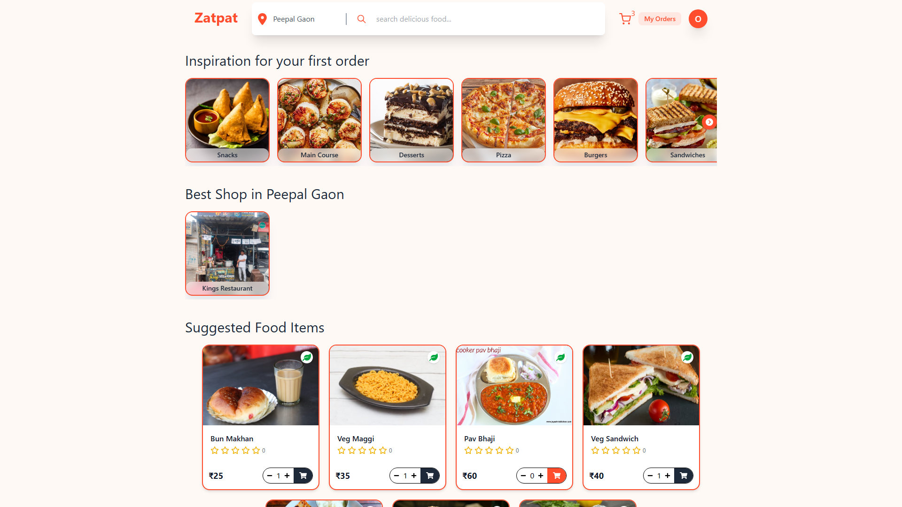
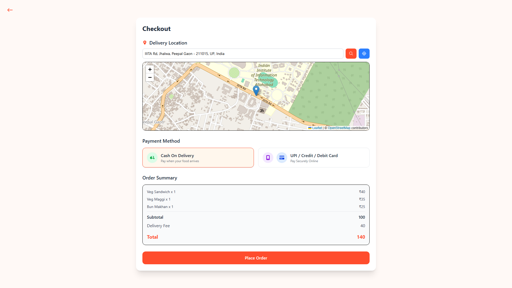
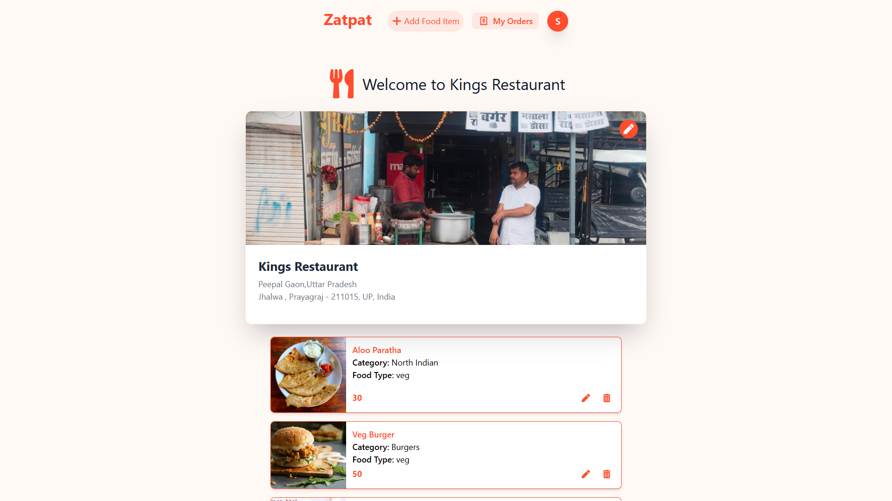
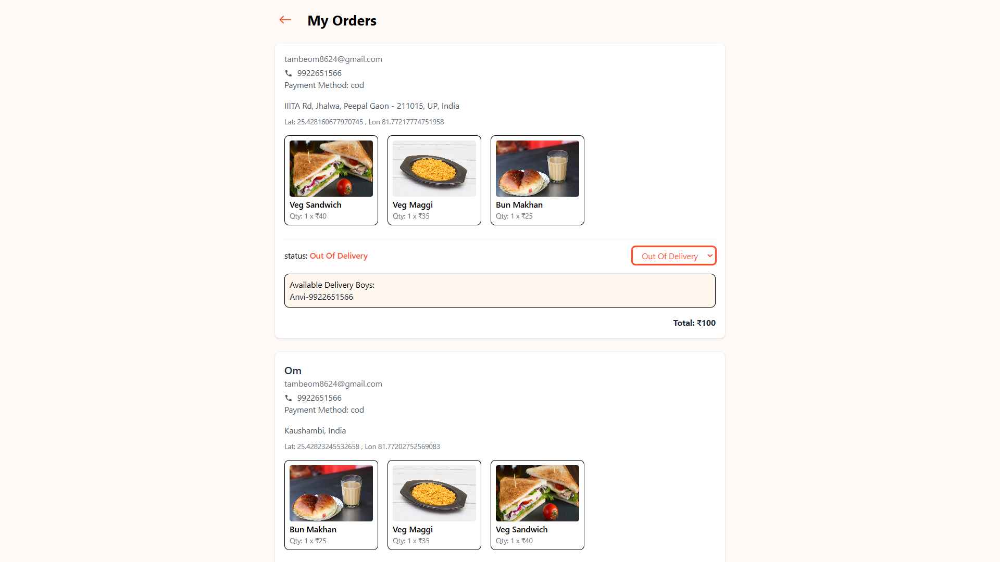
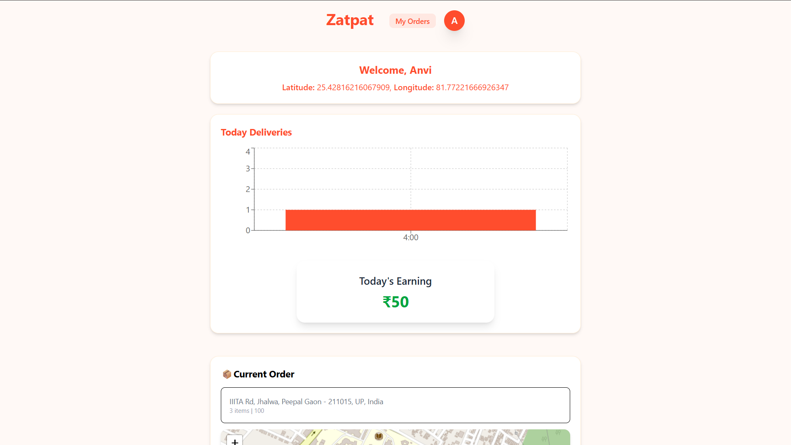
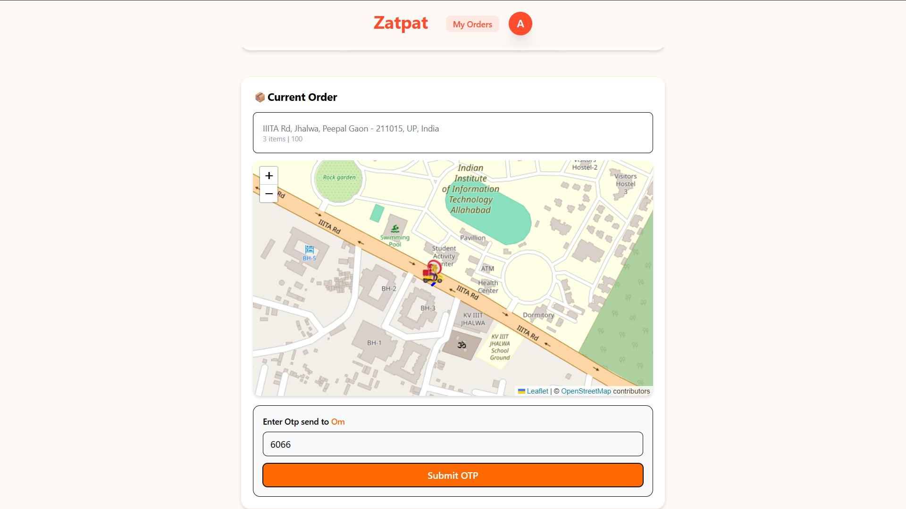

# 🛵 Zatpat - Hyperlocal Food Delivery, Neighbor Batch & Group Cart Platform


## 📋 Project Overview

**Zatpat** is an advanced, hyperlocal food delivery and logistics ecosystem built with the MERN stack and real-time WebSockets. In addition to end-to-end multi-role food ordering (Customer, Restaurant Owner, Delivery Rider), Zatpat features:

1. **Neighbor Batching (Community Delivery Pooling)**: Hyperlocal clustering within 300 meters of the initial order. When an order is placed, a 10-minute pooling window opens. Nearby neighbors receive real-time invites to order from the same restaurant and pool their delivery, unlocking up to **80% discount on delivery fees**. A single rider delivers all orders in a multi-stop route.
2. **Shared Group Cart**: Real-time collaborative ordering with friends, family, or colleagues. Join via a 6-character room code or QR link, add/edit menu items collaboratively via Socket.io, synchronize ready status, lock the cart, and split bills fairly with deterministic whole-rupee allocation.
3. **Gamification & Rewards**: Achievement badges (`Early Bird`, `Batch Captain`, `Eco Warrior`, `Street Legend`), total money saved tracking, and community milestones celebrating carbon and delivery cost savings.
4. **Hardened Architecture**: In-memory token bucket rate limiting on sensitive endpoints, MongoDB 2dsphere geospatial indexing, idempotent batch sweepers preserving all financial records, and an extensive native `node:test` suite.

---

## 📸 Application Layout & Screenshots

### 👤 Customer (User) View
| **Home & Food Menu** | **Real-Time Order Tracking** |
|:---:|:---:|
|  |  |
| *Browse restaurants, start a Neighbor Batch or Group Cart.* | *Live updates of rider location and multi-stop progress on the map.* |

### 👨‍🍳 Restaurant Owner (Admin) View
| **Merchant Dashboard** | **Order Management** |
|:---:|:---:|
|  |  |
| *Overview of total sales, active orders, and batch orders.* | *Accept/Reject orders and prepare batched dishes efficiently.* |

### 🛵 Delivery Partner (Rider) View
| **Rider Job Panel** | **Multi-Stop Navigation & Delivery** |
|:---:|:---:|
|  |  |
| *Accept batched multi-stop assignments with bonus pay.* | *Sequenced stop-by-stop navigation with per-stop OTP verification.* |

---

## 🚀 Core Feature Architecture

### 🏘️ 1. Neighbor Batching Engine
- **Hyperlocal Window**: Order creation opens a 10-minute window (`BATCH_WINDOW_MS = 600000`).
- **Geofence Radius**: Uses MongoDB `$near` 2dsphere queries to find active users within 300m (`BATCH_RADIUS_M = 300`).
- **Dynamic Tiered Discounts**: As neighbors join, the delivery fee drops progressively for **all** batch members. Overpayments (e.g. online prepaid orders) are automatically refunded via Razorpay upon batch closure.
- **Single Rider, Multi-Stop Logistics**: A single delivery partner is assigned to the entire batch. The rider navigates ordered stops (Stop 1, Stop 2...) with individual delivery OTP verification per stop.
- **Rider Compensation**: Base stop pay (₹50) + incentive bonus (₹20) per additional drop-off stop.

### 🛒 2. Shared Group Cart
- **Collaborative Order Room**: Host initiates a group cart for any restaurant, generating a unique 6-character code (e.g. `GF93KA`).
- **Real-Time Item Synchronization**: Emits `cartUpdated` over `cart:<code>` socket room whenever any participant updates quantity or adds items.
- **Participant Readiness & Lock**: Each participant toggles their "Ready" state. The host locks the cart to prevent edits during checkout.
- **Deterministic Fair Bill Split**: Accurately computes items total per person and distributes delivery fees equally. Any non-divisible odd rupees are assigned deterministically to the first participants so the sum of individual shares **strictly equals** the grand total down to the exact rupee.

### 🏆 3. Gamification & Community Rewards
- **Dynamic Tier Badges**:
  - 🌅 **Early Bird**: Joined a Neighbor Batch within the first 2 minutes of the window.
  - 👑 **Batch Captain**: Hosted 3 or more successfully closed Neighbor Batches.
  - 🌿 **Eco Warrior**: Participated in 5 or more batched deliveries (saving fuel & emissions).
  - ⚡ **Street Legend**: Participated in 10 or more batches.
- **Money Saved Tracker**: Lifetime delivery fee savings tracked and displayed in the `/rewards` dashboard.
- **Daily Fair-Play Limits**: Anti-abuse rate caps prevent spamming batch rewards (maximum 10 batched orders counted per day).

---

## 📊 Pricing Tiers & Tunables (`batch.config.js`)

| Configuration Parameter | Value | Description |
| :--- | :--- | :--- |
| `BATCH_WINDOW_MS` | `600,000 ms` (10 min) | Duration of the batch window before auto-dispatch |
| `BATCH_RADIUS_M` | `300 meters` | Maximum distance from anchor order to qualify for batch |
| `BATCH_MAX_MEMBERS` | `5 members` | Host + maximum 4 neighbors per delivery batch |
| `BATCH_MIN_ITEMS_TOTAL` | `₹99` | Minimum food items subtotal required to join a batch |
| `BASE_DELIVERY_FEE` | `₹40` | Standard single-order delivery charge |
| `FREE_DELIVERY_ABOVE` | `₹500` | Subtotal threshold qualifying for free delivery |
| `RIDER_PER_STOP_PAY` | `₹50` | Base delivery partner compensation per drop stop |
| `RIDER_EXTRA_STOP_BONUS` | `₹20` | Additional incentive bonus per pooled stop |

### Community Delivery Fee Discount Ladder

| Batch Member Count | Delivery Discount | Delivery Fee Paid (₹40 Base) | Total Savings |
| :---: | :---: | :---: | :---: |
| **1 Member** (Host) | **0%** | ₹40 | ₹0 |
| **2 Members** | **30%** | ₹28 | ₹12 each |
| **3 Members** | **50%** | ₹20 | ₹20 each |
| **4 Members** | **65%** | ₹14 | ₹26 each |
| **5 Members** (Full) | **80%** | **₹8** | **₹32 each** |

---

## 📡 Socket.io Real-Time Event Matrix

| Event Name | Direction | Room / Recipient | Payload Highlights | Description |
| :--- | :---: | :--- | :--- | :--- |
| `batchInvite` | Server ➔ Client | User Socket | `{ batchId, shopName, approxDistanceM, expiresAt, discountTiers }` | Notifies active neighbors within 300m that a batch window is open |
| `batchUpdate` | Server ➔ Client | `batch:<batchId>` | `{ batchId, memberCount, discountPct, expiresAt }` | Broadcasts new participant join/leave and updated discount tier |
| `batchClosed` | Server ➔ Client | `batch:<batchId>` & Member Sockets | `{ batchId, finalDiscountPct, finalDeliveryFee, refundAmount, totalSaved }` | Signals window closure, dispatches rider, and confirms refunds |
| `rewardEarned` | Server ➔ Client | User Socket | `{ badgeKey, badgeName, icon, description }` | Triggers celebratory animated toast when user earns a new achievement |
| `joinCart` | Client ➔ Server | Server Socket | `{ code }` | Joins client socket to collaborative `cart:<code>` room |
| `cartUpdated` | Server ➔ Client | `cart:<code>` | `{ code, shop, participants, total, billSplit }` | Real-time state synchronization when items or ready states change |
| `cartLocked` | Server ➔ Client | `cart:<code>` | `{ code, status: "locked" }` | Emitted when host locks cart to finalize ordering |
| `cartCheckedOut` | Server ➔ Client | `cart:<code>` | `{ code, orderId, totalAmount, shares }` | Notifies all room members that group checkout has completed |
| `joinOrderRoom` | Client ➔ Server | Server Socket | `orderId` | Subscribes client to live tracking updates for an order |
| `riderLocationUpdate`| Server ➔ Client | `order:<orderId>` | `{ latitude, longitude, heading }` | Broadcasts real-time rider GPS coordinates |

---

## 🌐 REST API Specification

### 📦 Neighbor Batch Endpoints (`/api/batch`)
| Method | Endpoint | Auth | Rate Limited | Description |
| :--- | :--- | :---: | :---: | :--- |
| `GET` | `/api/batch/nearby` | Yes | No | Fetch open batches within 300m of user's saved location |
| `GET` | `/api/batch/:batchId` | Yes | No | Retrieve live batch status, member count, and timer |
| `POST` | `/api/batch/:batchId/join` | Yes | **Yes** (Token Bucket: 5/min) | Join an open batch with own cart and address |
| `POST` | `/api/batch/:batchId/close` | Yes | No | Host manually finalizes batch window before timer ends |
| `POST` | `/api/batch/:batchId/leave` | Yes | No | Cancel pending or unpaid join before batch closure |

### 👥 Shared Group Cart Endpoints (`/api/group-cart`)
| Method | Endpoint | Auth | Rate Limited | Description |
| :--- | :--- | :---: | :---: | :--- |
| `POST` | `/api/group-cart/create` | Yes | No | Create new shared cart room for a shop; returns 6-char code |
| `GET` | `/api/group-cart/:code` | Yes | No | Get shared cart details, participant items, and bill split |
| `POST` | `/api/group-cart/:code/join` | Yes | No | Join an active shared cart session |
| `PUT` | `/api/group-cart/:code/items` | Yes | **Yes** (Token Bucket: 30/min) | Add/modify items in user's partition of the cart |
| `POST` | `/api/group-cart/:code/ready` | Yes | No | Toggle user readiness checkbox |
| `POST` | `/api/group-cart/:code/lock` | Yes | No | Host locks cart to proceed with checkout |
| `POST` | `/api/group-cart/:code/checkout`| Yes | No | Place master order and assign individual shares |

### 🏅 Gamification & Rewards Endpoints (`/api/user`)
| Method | Endpoint | Auth | Description |
| :--- | :--- | :---: | :--- |
| `GET` | `/api/user/rewards` | Yes | Retrieve user's unlocked badges, total money saved, and milestone progress |

---

## 🛡️ Reliability & Hardening Details

- **Atomic MongoDB Operations**: Batch joining utilizes `$expr: { $lt: [{ $size: "$members" }, "$maxMembers"] }` within `findOneAndUpdate` to prevent race conditions during high-concurrency join bursts.
- **In-Memory Token Bucket Rate Limiting**: Built with zero external dependencies to defend against join spamming and item update storms while automatically pruning idle keys.
- **Non-Destructive Sweeper**: `runBatchSweeper` runs on server startup and every 10 seconds. Expired batches are closed and marked `closed`; expired group carts are set to `status: "expired"`. No financial documents are ever deleted.
- **Native Test Suite**: Comprehensive tests written with Node.js 22 built-in `node:test` and `node:assert/strict` covering pricing tiers, haversine geofencing, bill-splitting down to the odd rupee, and concurrent join race conditions.

---

## 🧪 Running Tests

Run the built-in test suite:

```bash
cd Backend
npm test
```

Expected output:
```text
✔ Geospatial & Configuration Test Suite (13 tests passed)
✔ Join Race & Atomic Capacity Test Suite (3 tests passed)
✔ Pricing Utilities Test Suite (12 tests passed)
✔ Token Bucket Rate Limiter Test Suite (3 tests passed)

# tests 31
# suites 11
# pass 31
# fail 0
```

---

## ⚙️ Local Development Setup

### 1. Prerequisites
- Node.js (v18 or higher; v22 recommended)
- MongoDB instance (Local or MongoDB Atlas with 2dsphere index support)
- Razorpay account (for live payments and automated refunds)

### 2. Backend Setup
```bash
cd Backend
npm install
npm run dev
```

### 3. Frontend Setup
```bash
cd Frontend
npm install
npm run dev
```

Frontend will run at `http://localhost:5173` and backend at `http://localhost:5000`.

---

## 👤 Author

**Om Tambe**
- 🌐 Portfolio: [omtambeportfolio.vercel.app](https://omtambeportfolio.vercel.app)
- 💼 LinkedIn: [linkedin.com/in/om-tambe09](https://linkedin.com/in/om-tambe09)
- 📧 Email: tambeom09official@gmail.com

⭐ If you find this project helpful, please consider starring the repository!
